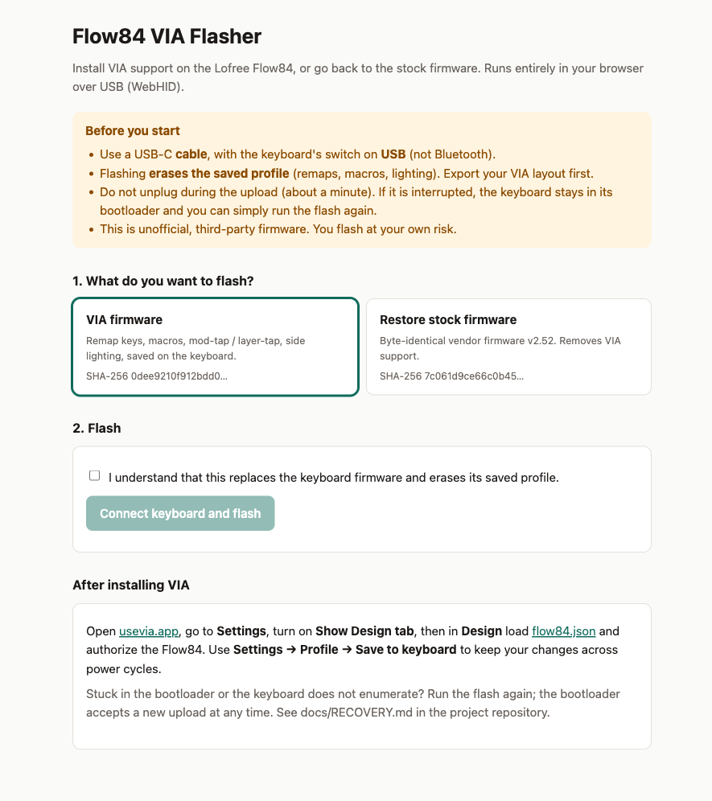

# Flow84 VIA

A VIA-compatible firmware patch for the **Lofree Flow84** keyboard (stock firmware OE915 v2.52).

> **Read this first.**
> * This is an unofficial hobby project, not affiliated with or supported by Lofree.
> * **So far it has been tested on exactly one keyboard: the maintainer's own.** Other units,
>   hardware revisions or firmware versions may behave differently.
> * Flashing always carries a risk of bricking the keyboard. Read [docs/RECOVERY.md](docs/RECOVERY.md)
>   before you start. You do this at your own risk.
> * It is **not QMK** and not a full VIA implementation (see [What this is, and what it is not](#what-this-is-and-what-it-is-not)).

## Why this exists

The Flow84 is a lovely low-profile keyboard, but Lofree ships it with no software at all:
no remapping tool, no macros, no way to change what a key does. I wanted to keep using
mine for a long time, and I wanted it to do more than the factory layout allows, so I
decided to give it a second life instead of waiting for a vendor that is not going to
come.

There are no firmware sources, and no QMK or ZMK port exists for this chip. So the only
way in was the hard way: I disassembled the original firmware, worked out how its key
scanning, USB code, macro player and settings storage behave, and then wrote small pieces
of new code that live in unused space of the original image and hook into it. Everything
the keyboard did before still works; the patch only adds on top.



## What you get

| Feature | Notes |
|---|---|
| Key remapping on all four layers | Windows / Mac × base / Fn, live in VIA |
| Mod-tap `MT(mods, kc)` and layer-tap `LT(1\|3, kc)` | up to 2 positions per Windows/Mac pair; timeout setting in VIA |
| Macros `M0..M7` | text, key taps/down/up, delays; run on the stock macro player |
| White key backlight 0..4, side RGB color (8) and On/Off | controls in the VIA menu |
| **Save to keyboard** | stores everything on the keyboard; survives power cycles |
| Bypass mode | hold any key while plugging in USB to run as stock |

## What this is, and what it is not

* It is the **original Lofree firmware plus a patch**: new code is appended to the stock
  image and a few dozen call sites are redirected into it. It is not a rewrite.
* VIA support is a **compatibility layer**: the keyboard speaks the VIA protocol so the
  VIA web app can configure it. It is **not QMK**. There are no QMK layers, no combos,
  no tap dance, no RGB matrix effects, and VIA features beyond those listed here do not exist.
* Some things are new functionality built for this keyboard (mod-tap / layer-tap, saving the
  profile to the keyboard, the macro bridge), and some are the stock functionality exposed
  through VIA (the stock macro player, Bluetooth keys, backlight).
* Many things are limited by the hardware or by what could be found out about the firmware.
  The list below is long on purpose.

## Limitations

* **One tested keyboard.** Everything here was verified on one Flow84 over USB.
  Sleep/wake and Bluetooth were not specifically tested with this firmware.
* **Flashing erases your saved profile.** Export your VIA layout first. It is a property of
  the vendor update procedure and cannot be avoided.
* **Saved profile size is small.** Up to 85 changed keys, a 192-byte macro buffer and the
  settings share one 476-byte flash area. If it does not fit, Save fails before writing.
  The firmware cannot write its own code area, and the board has no EEPROM
  ([how it is stored](docs/PERSISTENCE.md)).
* **Layers.** VIA shows four layers (Windows/Mac × base/Fn). The Windows/Mac switch stays
  hardware; arbitrary layer keys are rejected.
* **Mod-tap and layer-tap** work on at most two keys per Windows/Mac pair, send the tap on
  key *release* (a small delay), and are best kept off Space and letters. The timeout is in
  internal processing passes, not exact milliseconds ([details](docs/TAP_HOLD.md)).
* **Macros** use the stock player: ASCII text (US layout), key taps/holds and delays. No media
  keys, no non-US characters; the delay unit is an interrupt tick (about 1 ms, not measured).
* **Lighting.** White key backlight (0..4) and the side RGB panels (8 colors, on/off). The
  stock lighting effects are not exposed.
* Anything the stock firmware does that has no VIA equivalent stays as it was.
* Flashing works over USB only.

## Install (web flasher)

1. Open the flasher page (this repository's GitHub Pages site) in Chrome, Edge, Brave or Opera.
2. Connect the keyboard with a **USB cable**, switch set to USB.
3. Pick **VIA firmware**, tick the acknowledgement and click **Connect keyboard and flash**.
   Select the keyboard and, if asked, the bootloader device. The upload takes about a minute.
4. Open [usevia.app](https://usevia.app) → Settings → enable *Show Design tab* → Design →
   load `definitions/flow84.json` (also offered on the flasher page) → authorize the Flow84.

Changes in VIA apply immediately but survive a power cycle only after
**Settings → Profile → Save to keyboard**. To go back to the original firmware, use
**Restore stock firmware** on the same page (see [docs/RECOVERY.md](docs/RECOVERY.md)).
Bypass mode: hold any key while plugging in USB and the keyboard runs as stock.

## Documentation

[Architecture](docs/ARCHITECTURE.md) · [VIA protocol](docs/VIA.md) ·
[Persistence](docs/PERSISTENCE.md) · [Tap-hold](docs/TAP_HOLD.md) ·
[Macros](docs/MACROS.md) · [Memory and bootloader](docs/MEMORY.md) ·
[Recovery](docs/RECOVERY.md) · [Development](docs/DEVELOPMENT.md)

## Repository layout

```
firmware/     C sources and assembly of the patch
tools/        build, flasher CLI, VIA reference model, device diagnostics
tests/        emulator-based and native tests
web/          the browser flasher (WebHID)
definitions/  VIA JSON definition
stock/        the unmodified vendor firmware (used to build and to restore)
docs/
```

## Made with AI

This project was developed with substantial help from an AI assistant (Anthropic's Claude),
working under the direction of the maintainer: the reverse-engineering analysis, the firmware
patch, the tools, the tests, the web flasher and this documentation were largely written by
the AI and reviewed and run on real hardware by the maintainer. Treat it like any
community firmware: read the code, check the tests, and flash at your own risk.

## Stock firmware notice

`stock/CompxUpgradeBinFile.bin` is the unmodified, vendor-supplied OE915 v2.52 update
file, included so the patch can be built reproducibly and the keyboard can be restored.
It is Lofree's property and is not covered by this project's license. If the rights
holder objects it will be removed.

## Acknowledgements

The container format, the update-mode handshake and the first Flow84 key matrix map were
worked out by the community project
[ennis-ma/lofree-flow-key-remapper](https://github.com/ennis-ma/lofree-flow-key-remapper);
this repository re-implements what it needs independently from its own reverse engineering.

## License

MIT for the code in this repository (see [LICENSE](LICENSE)); the stock firmware is excluded.
