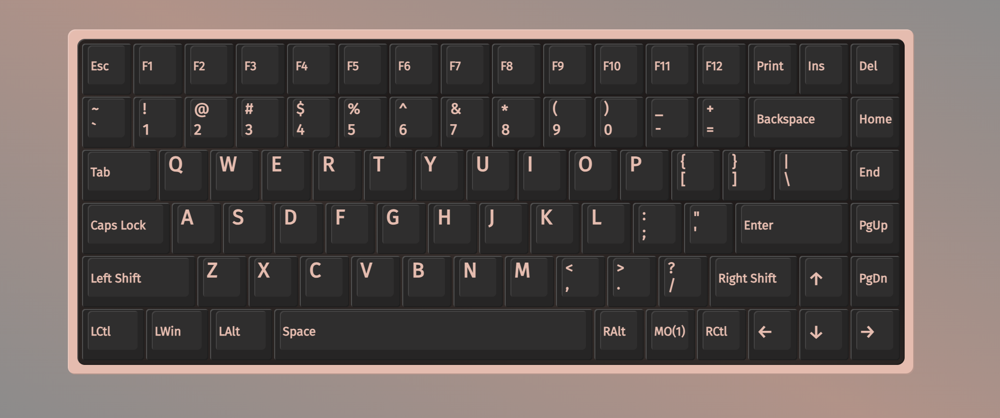

<h1 align="center">Lofree Flow84 VIA</h1>

<p align="center"></p>

<p align="center"><i>The Flow84 in the VIA web app: remap keys, record macros, set lighting, save it all on the keyboard.</i></p>

A VIA-compatible firmware patch for the **Lofree Flow84** keyboard (stock firmware OE915 v2.52). A Flow100 version is planned.

> **Read this first.**
> * This is an unofficial hobby project, not affiliated with or supported by Lofree.
> * **Tested only on the Lofree Flow84** (84 keys), on one unit, over USB. **Flow100 (100 keys) support is
>   still in development and not tested: do not flash this firmware to a Flow100.** Other units,
>   hardware revisions or firmware versions may behave differently.
> * Flashing always carries a risk of bricking the keyboard. Read [docs/RECOVERY.md](docs/RECOVERY.md)
>   before you start. You do this at your own risk.
> * **Your changes are NOT saved automatically.** After you change anything in VIA (keys, macros,
>   lighting, tap-hold timeout), open the **Flow84** tab and press **Save to keyboard**.
>   Without it, everything resets to the last saved state when the keyboard loses power.
> * It is **not QMK** and not a full VIA implementation (see [What this is, and what it is not](#what-this-is-and-what-it-is-not)).

**Web flasher: <https://vsydorenko91.github.io/lofree-flow-via/>**

## Why this exists

The Flow84 is a lovely low-profile keyboard, but Lofree ships it with no software at all:
no remapping tool, no macros, no way to change what a key does. I wanted to keep using
mine for a long time, and I wanted it to do more than the factory layout allows.

There are no firmware sources, and no QMK or ZMK port exists for this chip. So the only
way in was the hard way: I disassembled the original firmware, worked out how its key
scanning, USB code, macro player and settings storage behave, and then wrote small pieces
of new code that live in unused space of the original image and hook into it. Everything
the keyboard did before still works; the patch only adds on top.

<p align="center"></p>

<p align="center"><i>The browser flasher: install the VIA firmware or go back to stock, no tools to install.</i></p>

## What you get

| Feature | Notes |
|---|---|
| Key remapping on all four layers | Windows / Mac × base / Fn, live in VIA |
| Mod-tap `MT(mods, kc)` and layer-tap `LT(1\|3, kc)` | up to 4 positions per Windows/Mac pair; timeout and hold rule selectable in VIA |
| Macros `M0..M7` | text, key taps/down/up, delays; run on the stock macro player |
| White key backlight 0..4, side RGB color (8) and effect (steady / breathing / off) | controls in the VIA menu |
| **Save to keyboard** | stores everything on the keyboard; survives power cycles |
| Reset to factory | one button in the VIA menu: factory keys and empty macros |
| Profile backup | the web flasher keeps your profile across firmware updates |

## What this is, and what it is not

* It is the **original Lofree firmware plus a patch**: new code is appended to the stock
  image and a few dozen call sites are redirected into it. It is not a rewrite.
* VIA support is a **compatibility layer**: the keyboard speaks the VIA protocol so the
  VIA web app can configure it. It is **not QMK**. There are no QMK layers, no combos,
  no tap dance, no RGB matrix effects, and VIA features beyond those listed here do not exist.
* Some things are new functionality built for this keyboard (mod-tap / layer-tap, saving the
  profile to the keyboard, the macro bridge), and some are the stock functionality exposed
  through VIA (the stock macro player, Bluetooth keys, backlight).
* Many things are limited by the hardware or by what could be found out about the firmware.
  The list below is long on purpose.

## Limitations

* **Flow84 only, one tested unit.** Everything here was verified on one Flow84 over USB. The Flow100 is not supported yet.
  Sleep/wake and Bluetooth were not specifically tested with this firmware.
  Of the 0.3.0 additions, flashing, the firmware start and saving a restored profile were
  checked on the keyboard; the tap-hold decision modes, the third and fourth tap-hold key, the
  reset button and the flasher's automatic profile restore are so far verified in the emulator.
* **Flashing erases your saved profile.** It is a property of the vendor update procedure. When
  the keyboard already runs this firmware, the web flasher backs the profile up (keys, macros,
  lighting, tap-hold timeout) before flashing, restores and saves it afterwards, and offers the
  backup as a file.
* **Saved profile size is small.** Up to 85 changed keys, a 192-byte macro buffer and the
  settings share one 476-byte flash area. If it does not fit, Save fails before writing.
  The firmware cannot write its own code area, and the board has no EEPROM
  ([how it is stored](docs/PERSISTENCE.md)).
* **Layers.** VIA shows four layers (Windows/Mac × base/Fn). The Windows/Mac switch stays
  hardware; arbitrary layer keys are rejected.
* **Mod-tap and layer-tap** work on at most four keys per Windows/Mac pair and send the tap on
  key *release* (a small delay). The timeout (120–500 ms) and the rule that turns a tap into a
  hold are selectable in VIA; for keys you type through, such as Space, pick *When another key
  is pressed and released* ([details and an example](docs/TAP_HOLD.md)).
* **Macros** use the stock player: ASCII text (US layout), key taps/holds and delays. No media
  keys, no non-US characters; the delay unit is an interrupt tick (about 1 ms, not measured).
* **Lighting.** White key backlight (0..4) and the side RGB panels (8 colors; steady, breathing or off).
* Anything the stock firmware does that has no VIA equivalent stays as it was.
* Flashing works over USB only.

## Install (web flasher)

1. Open the flasher: **<https://vsydorenko91.github.io/lofree-flow-via/>** in Chrome, Edge, Brave or Opera
   (Firefox and Safari do not support WebHID).
2. Connect the keyboard with a **USB cable**, switch set to USB.
3. Pick **VIA firmware**, tick the acknowledgement and click **Connect keyboard and flash**.
   Select the keyboard and, if asked, the bootloader device. The upload takes about a minute.
4. Open [usevia.app](https://usevia.app) → Settings → enable *Show Design tab* → Design →
   load `definitions/flow84.json` (also offered on the flasher page) → authorize the Flow84.

**Important:** changes in VIA apply immediately, but they are kept across power cycles only after
you press **Flow84 → Save to keyboard** (the *Unsaved changes* indicator there shows
whether anything is pending). Otherwise the keyboard returns to its last saved state when it is
disconnected or powers off. To go back to the original firmware, use
**Restore stock firmware** on the same page (see [docs/RECOVERY.md](docs/RECOVERY.md)).

## Documentation

[Architecture](docs/ARCHITECTURE.md) · [VIA protocol](docs/VIA.md) ·
[Persistence](docs/PERSISTENCE.md) · [Tap-hold](docs/TAP_HOLD.md) ·
[Macros](docs/MACROS.md) · [Memory and bootloader](docs/MEMORY.md) ·
[Recovery](docs/RECOVERY.md) · [Development](docs/DEVELOPMENT.md)

## Repository layout

```
firmware/     C sources and assembly of the patch
tools/        build, flasher CLI, VIA reference model, device diagnostics
tests/        emulator-based and native tests
web/          the browser flasher (WebHID)
definitions/  VIA JSON definition
stock/        the unmodified vendor firmware (used to build and to restore)
docs/
```

## Stock firmware notice

`stock/CompxUpgradeBinFile.bin` is the unmodified, vendor-supplied OE915 v2.52 update
file, included so the patch can be built reproducibly and the keyboard can be restored.
It is Lofree's property and is not covered by this project's license (see `stock/NOTICE`). If the rights
holder objects it will be removed.

## License

MIT for the code in this repository (see [LICENSE](LICENSE)); the stock firmware is excluded.
